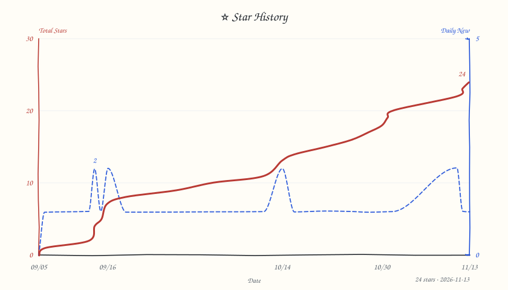

# 爱生活（iLife）

DSH（DeepSeek Harness）里的居家生活套件：一个仓库，七个可独立安装的插件。

每个插件都是一条命令装好；装哪一个，DSH 里就多出哪一个能力。全部能力都住在 DSH 设置弹窗的「爱生活」卡里，以及各自技能页上。

## 装

每个能力都是一条命令装好。**单品要和总管写进同一条命令**——装配只认直接依赖，单装单品不会把「爱生活」卡激活：

```sh
dsh plugin add dsh-life-pack                      # 先装卡本身
dsh plugin add dsh-life-pack dsh-calorie          # 卡 ＋ 卡路里
dsh plugin add dsh-life-pack dsh-chef             # 再装一家，照同样的写法
```

## 七个插件

| 包 | 目录 | 做什么 |
| --- | --- | --- |
| `dsh-life-pack` | `packages/plugin-manager` | 「爱生活」卡本身：六个技能的设置页排成一排页签，＋ 配置体检、更新区 |
| `dsh-bill-ilife` | `packages/plugin-bill-ilife` | 饼干记账：收支、退款、报销、借还、分期、账户与账本 |
| `dsh-calorie` | `packages/plugin-calorie` | 卡路里：饮食、体重、运动、体脂围度、目标与复盘 |
| `dsh-chef` | `packages/plugin-chef` | 私家大厨：菜谱、跟着做、买菜清单、做菜记录 |
| `dsh-home-ilife` | `packages/plugin-home-ilife` | 居家管家：物品、位置、快递、保修、证件 |
| `dsh-memo-ilife` | `packages/plugin-memo-ilife` | 备忘录：按关键词／时间／分类搜与记，提醒与心愿排期 |
| `dsh-schedule-ilife` | `packages/plugin-schedule-ilife` | 作息管家：作息记录、时间轴、日程计划与复盘 |

技能包（`packages/skill-*`）提供每个域的数据面与命令行；`dsh-*` 插件把它们接到 DSH 的设置页与页面上。公共层在 `packages/base-*`（联动取数、页面渲染、语义组合）。

## 版本

- 七个插件当前版本：`0.3.88`（2026-11-04，npm `latest`）
- 更新系统：`dsh-plugin-update 0.18.39`（总管以 `^0.18.39` 依赖引入；传递带入 `dsh-log 0.3.4`）
- 升级：插件市场里点升级，或把上面那条安装命令重跑一遍
- 更新说明：[GitHub Releases](https://github.com/FeatherHunter/ilife/releases)

## 配置与数据

- 配置：`~/.ilife/<技能>.yaml`，一个技能一份，在各自的设置页里改
- 数据：默认 `~/.ilife/data`（库文件与各技能产出的页面）
- 页面产物：按技能各自的输出目录（卡路里＝数据目录下的 `calorie_html/`）

## 开发

```sh
pnpm install
pnpm build          # tsc -b ＋ 各插件客户端产物
pnpm test           # 全仓测试
```

写代码前读 `AGENTS.md` 与 `docs/agents/` 下的纪律件（结构、用词、命令登记、发版、并发）。

## 链接

- 问题与建议：<https://github.com/FeatherHunter/ilife/issues>
- 许可：MIT

## 致谢

感谢每一位提交 Issue、PR 与参与讨论的朋友，是你们让这个插件一点点变好。

<!-- THANKS-TABLE-ZH-START -->
| 贡献者 | 致敬 | 贡献 |
| --- | --- | --- |
<!-- THANKS-TABLE-ZH-END -->

也感谢在评论区与讨论区留下想法的每一位朋友。如果你也遇到了问题或有新想法，欢迎直接提 Issue 或发起讨论。

<!-- 英文表预留：docs/README.en.md 建页后启用英文标记，与中文表同源渲染。 -->

<!-- CONTACT-START -->
<div align="center">

## 反馈与联系

</div>

<div align="center">

👏欢迎提交PR、ISSUE。星星之火可以燎原🔥有任何建议、意见、想法、吐槽、idea都可以进群交流。

<table align="center"><tr><td align="center"><b>飞书群（主）</b></td><td align="center"><b>QQ群（新）</b></td><td align="center"><b>微信群（新）</b></td></tr><tr><td></td><td></td><td></td></tr></table>

</div>
<!-- CONTACT-END -->

<!-- STAR-HISTORY-START -->
<div align="center">

  <picture>
    <source media="(prefers-color-scheme: dark)" srcset="https://raw.githubusercontent.com/FeatherHunter/ilife/master/docs/star-history-dark.svg?v=202611010000" />
    <source media="(prefers-color-scheme: light)" srcset="https://raw.githubusercontent.com/FeatherHunter/ilife/master/docs/star-history-light.svg?v=202611010000" />
  
  </picture>

</div>
<!-- STAR-HISTORY-END -->

<!-- MORE-START -->
<h2 align="center"><sub>MORE</sub><br>作者的其他作品</h2>

<div align="left">

喜欢这个插件的话，这些可能你也用得上：

**[dsh-mattpocock-skills-deck](https://github.com/FeatherHunter/dsh-mattpocock-skills-deck)** —— 近 30 万 star 的 mattpocock/skills 整套预置好（27 个技能），装好即用。

**[dsh-prompt](https://github.com/FeatherHunter/dsh-prompt)** —— 经常反复重复的模板化提示词，存成自定义模板，选中后直接注入，不再需要耗费精力。

**[dsh-opencode-palette](https://github.com/FeatherHunter/dsh-opencode-palette)** —— 38 款 opencode 经典配色 + 20+自定义主题 一键换装 DSH。

**[dsh-im-companion](https://github.com/FeatherHunter/dsh-im-companion)** —— 给 dsh-im 加了「助理」和「家」的概念。

</div>
<!-- MORE-END -->
